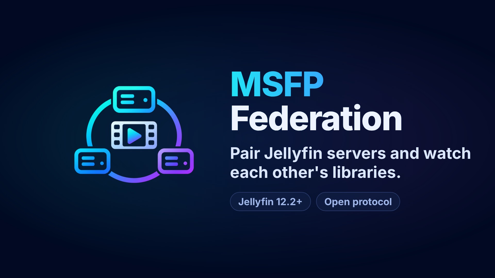

[](https://jellywatch.app/hub/msfp-federation)

Share your Jellyfin libraries with friends, and enjoy theirs alongside your own.

MSFP Federation connects independently run media servers, allowing them to selectively share their libraries. Your friends' films and series appear right inside your Jellyfin, ready to watch with your usual apps and accounts.

Everyone keeps their own server, their own files, and control over what they share. No shared accounts, no central server.

> **Early development:** The plugin works, but it's still young. Try it on a test server first, and only pair with people you know.

## A federation beyond Jellyfin

MSFP (Media Server Federation Protocol) is an open protocol designed to let different media server platforms federate with one another.

The idea is simple: you shouldn't have to run the same software as your friends to share your media libraries. A Jellyfin server should be able to share with an Overfin server, and eventually with other platforms, without relying on a central service or shared user accounts.

This plugin brings MSFP to Jellyfin. [Overfin](https://github.com/Overfin/server) is another compatible implementation, and other media servers are welcome to join the ecosystem.

See the [MSFP specification](https://github.com/msfp-io/msfp-spec).

## What you get

Your friends' libraries become part of your Jellyfin experience.

- **Browse their collections:** Films and series appear in two additional libraries, complete with posters, descriptions and metadata.
- **Use your usual apps:** Everything works through your existing Jellyfin clients. No additional accounts or applications.
- **A proper playback experience:** Their titles play like your own files: subtitles (including image-based ones), seek-bar previews, intro and credits markers, audio track selection, special features and trailers. Theme songs and videos too, if you switch them on.
- **Smart source selection:** When multiple friends have the same title, the best available source is tried first, with fallback to another server when one is busy.
- **Progress that follows you:** If you get your own copy of something you were watching from a friend's server, your viewing progress carries over.

Titles you already have aren't duplicated. Films and series are shared once identified through TMDB (or TheTVDB for series only it knows); titles neither knows only if you switch that on. Music isn't supported.

## Your server. Your rules.

Federation doesn't mean giving someone access to your server. You decide exactly what other servers can see and how much of your resources they can use.

- **Choose what you share.** Select which libraries are available to each server or an entire group. Nothing is shared until you explicitly allow it.
- **Control access.** A server you pair with directly is accepted only after you verify its fingerprint with its owner; in a group, the group vouches for its members. You can disconnect a server, leave a group or block another server at any time.
- **Set resource limits.** Configure simultaneous streams, transcoding sessions and bitrate. Your own users always take priority: friends' streams won't cause your own users to be refused.
- **Keep viewers private.** The other server sees the metadata of the libraries you share, including language and picture quality information. It doesn't get access to your files, folders or users. When someone watches one of your titles, your server knows which remote server is streaming it, but not which individual user.

### A note about bandwidth

Your internet connection carries the streams. When a friend watches one of your films, your server sends it over your upload connection. When your users watch a friend's film, it comes in over your connection.

A home internet connection with limited upload bandwidth may restrict how many people can watch simultaneously. That's why the plugin provides per-server and group resource limits.

## How it works

Getting started with a friend is straightforward:

1. **Pair your servers.** One of you generates a pairing code and sends it to the other. The receiving server uses the code to initiate the connection, and the owner accepts it after verifying the server's fingerprint.
2. **Choose what to share.** Each server independently decides which libraries the other is allowed to see.
3. **Browse their libraries.** Shared films and series appear in the additional federation libraries created by the plugin.
4. **Press play.** Your Jellyfin server reads the file from your friend's server and plays it to your users as it would a file of your own, converting it here when their device needs it. They only communicate with your server, and the remote server never learns their identities.

A few friends can also form a **group**. Instead of manually pairing every server, members join through a group invitation and establish their connections through the group. Sharing permissions and resource limits can then be managed for the group as a whole.

## What you need

- Jellyfin 12.2 or later.
- A publicly reachable HTTPS address for your Jellyfin server, just as when accessing it away from home.
- Another server running this plugin or a compatible MSFP implementation, such as [Overfin](https://github.com/Overfin/server).

Jellyfin's own HTTPS configuration or a reverse proxy will work. A self-signed certificate is also supported.

## Getting started

### 1. Install the plugin

In Jellyfin, open **Dashboard → Plugins → Repositories** and add the following repository:

```text
https://c0pt3r.github.io/jellyfin-plugin-msfp/manifest.json
```

Open the plugin **Catalog**, find **MSFP Federation**, and install it.

Restart Jellyfin. Future updates will be available through the same catalog.

### 2. Configure your server

Open **Dashboard → Plugins → MSFP Federation**.

Under **Settings**, configure:

- **This server's address:** The HTTPS address other servers will use to reach yours (for example, `https://media.example.org`). Federation remains disabled until this is configured.
- **This server's name:** An optional name that your friends will see.
- **Transcodes at once:** The maximum number of simultaneous conversions allowed on your server, shared between your own users and remote viewers. The default is 2. Set it to 0 to prevent remote viewers from using transcoding.
- **Burn subtitles into the picture for paired servers:** Lets a paired server ask for subtitles drawn into the picture, which costs a conversion. Off by default.
- **Play paired servers' theme songs and videos:** Their titles' themes play on a title's page, as your own do. Each one is a playback on the paired server, which so learns which page was opened. Off by default.

Save your settings. The **This server** tab displays your server's fingerprint, which identifies it to other servers.

### 3. Pair with a friend

Under **Individual**, one of you clicks **Invite a server** and sends the generated code to the other.

The other server clicks **Use a code** and enters it. The code's destination and details are displayed before proceeding.

The server that generated the code will now see the other server as **Waiting for you**.

Before accepting, compare the two servers' fingerprints with their respective owners through a trusted communication channel, such as a phone call. If they match, click **Accept**.

Pairing codes are single-use and normally expire after one day. You can change their validity and capacity (up to 100 servers and 30 days).

Once paired, click **Manage…** on the other server's entry to configure sharing:

- **You share with it:** Choose which of your libraries the other server can access. Nothing is shared by default.
- **You show on your server:** Choose which of its libraries appear in your Jellyfin. All libraries are shown by default, including new ones.
- **What its viewers may use here:** Configure simultaneous streams, transcoding sessions and bitrate limits. The defaults are 2 streams, 1 transcode and no bitrate cap. Downloads and scans are off (0) unless you allow some.

Your friend's titles should now appear in the two federation libraries:

- Films from paired servers
- Series from paired servers

Users who can access all libraries will see them automatically. For other users, grant access to these two additional libraries in their Jellyfin library permissions.

### 4. Create a group (optional)

If you have several friends, groups make managing federation easier.

Under **Groups**, click **Create a group**. You become its owner.

- **Invite…** generates an invitation code for the group. A server that uses it waits for you to accept it, as with any code; once accepted, it's a member.
- The new member then asks every other member to pair. Each member answers with **Answer…** or **Open…**: **Pair** or **Refuse**. No fingerprint to compare: the group vouches for its members.
- **Settings…** configures which libraries you share with the group, one pool of streams and transcodes for all its members together, and whether your server automatically accepts new members.

Group owners can appoint administrators, designate an heir, manage membership and settings, transfer ownership or dissolve the group.

Members can leave a group while keeping or ending their existing pairings, and can block other members independently.

A server already paired with you can also use your group's invitation code.

## When titles aren't recognized

Before sharing a film or series, the plugin identifies it through TMDB.

Titles that cannot be confidently identified aren't shared automatically. Instead, they appear under **Identification**, where you can review the suggested matches or enter a TMDB ID manually.

This avoids sharing the wrong film or series when folder names are ambiguous or metadata is incomplete.

## Troubleshooting

- **Federation is disabled:** The plugin displays the reason at the top of its page. Usually, the server address is missing or isn't HTTPS.
- **A paired server shows "Titles not read":** The line under it says why. "It runs an older draft of the protocol" means it still runs this plugin 0.10 or earlier (or an Overfin of that time): 0.11.0 and later can't read it, nor it them, until it updates. The pairing is kept meanwhile.
- **The other server reports an incompatible protocol version:** Update both servers to their latest plugin or Overfin versions.
- **Your server's key was stolen:** For example, if a backup containing your server's private key was exposed, use **This server's key was stolen** under the **This server** tab. Paired servers will stop trusting the old key and follow your server to its replacement.
- **You move your server:** Update **This server's address** under Settings and save. Paired servers are notified of the change.

## Learn more

- [MSFP specification](https://github.com/msfp-io/msfp-spec): the protocol itself.
- [SECURITY.md](SECURITY.md): the plugin's security rules, what paired servers learn, and how to report a vulnerability.
- [TECHNICAL.md](TECHNICAL.md): building, certificates, reverse proxies and playback architecture.
- [SPEC-GAPS.md](SPEC-GAPS.md): known protocol gaps and areas for improvement.
- [DESIGN-NOTES.md](DESIGN-NOTES.md): design decisions and future directions.

## How it's made

MSFP Federation for Jellyfin is designed and maintained by its project maintainer, who makes the architecture, security and product decisions. The code is written by Claude (Anthropic's AI), with its contributions identified through `Co-Authored-By: Claude` commit trailers.

The project is tested through its automated test suite and MSFP's conformance suite, but has not yet undergone an independent security audit.

## License

GPL-3.0. See [LICENSE](LICENSE).
